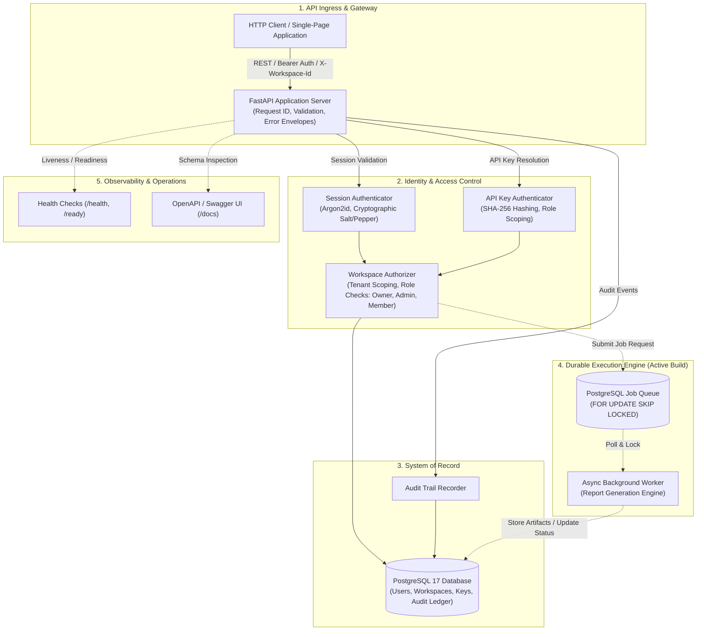

# Backend Infra: Multi-Tenant Backend Systems Platform

[](https://www.python.org/downloads/)
[](https://fastapi.tiangolo.com)
[](https://www.postgresql.org/)
[](https://www.sqlalchemy.org/)
[](https://alembic.sqlalchemy.org/)
[](https://docs.astral.sh/ruff/)
[](https://opensource.org/licenses/MIT)

> **Backend Infra** is an enterprise-grade, API-first backend systems platform engineered with Python 3.13, FastAPI, PostgreSQL 17, and SQLAlchemy 2.0. Built around a modular monolith architecture where the API and asynchronous worker share application domain logic and a single database system of record, it provides multi-tenant workspace isolation, dual authentication vectors (bearer-token sessions and scoped API keys), deterministic audit logging, and a PostgreSQL-backed durable background job execution engine.

---

## Architecture Overview



Solid connections represent verified active paths. Dashed connections represent the planned durable job-processing pipeline currently under development.

---

## Core Capabilities

- **Modular Monolith Architecture:** Shared domain entities and relational persistence between API and worker processes, preventing distributed system complexity while maintaining isolated execution boundaries.
- **Multi-Tenant Workspace Scoping:** Multi-tenant workspace isolation where users belong to one or more workspaces with role-based access control (owner, admin, member), enforced on every protected endpoint.
- **Dual Authentication Vectors:** Stateful bearer-token user sessions with secure password hashing (Argon2id with cryptographic pepper) alongside headless API keys with SHA-256 hashing, instant revocation, and workspace role scoping.
- **Predictable API Contracts:** Strict versioned routing (/v1), automated request validation via Pydantic v2, standardized error response envelopes (code, message, details, request_id), and interactive OpenAPI documentation.
- **Immutable Audit Trail:** Dedicated audit logging for security-critical actions, workspace membership changes, and authentication lifecycle events directly in PostgreSQL.
- **Durable Relational Persistence:** Fully typed SQLAlchemy 2.0 integration with declarative Alembic schema migrations and foreign-key integrity constraints.
- **PostgreSQL-Backed Asynchronous Queue (Active Build):** Native transactional queueing utilizing PostgreSQL row-level locks (FOR UPDATE SKIP LOCKED) to guarantee at-least-once job delivery without an external message broker.
- **Zero-Docker Native Development:** Lightweight Windows local environment powered by automated portable PostgreSQL 17 provisioning on loopback, requiring no container runtime for local execution.

---

## Project Structure

```text
backend-infra/
├── backend/
│   └── app/
│       ├── api/                      # Routing, dependencies, auth context
│       │   ├── routes/               # Versioned endpoint controllers (auth, workspaces)
│       │   └── deps.py               # Dependency injection & security resolvers
│       ├── core/                     # Application settings, errors, logging, security
│       ├── db/                       # Database engine, session factories, base models
│       ├── domain/                   # Business rules and state transitions
│       ├── models/                   # Declarative SQLAlchemy domain entities
│       ├── repositories/             # Data access layer & query abstractions
│       ├── schemas/                  # Pydantic v2 request/response schemas
│       ├── services/                 # Application services (auth, workspaces, audit)
│       └── workers/                  # Asynchronous worker entry points
├── migrations/                       # Alembic schema version history & migrations
│   └── versions/                     # Versioned migration revisions
├── scripts/                          # Developer utilities and database setup
│   └── dev/                          # Portable PostgreSQL 17 provisioning scripts
├── tests/                            # Unit and PostgreSQL-backed integration test suite
├── docs/                             # Engineering specs, ADRs, runbooks & journal
│   ├── decisions/                    # Architecture Decision Records (ADR-001 to ADR-003)
│   ├── DOCUMENTING.md                # Engineering journal & single source of truth
│   ├── ARCHITECTURE.md               # Monolith design, boundaries & data access
│   ├── API_SPECIFICATION.md          # REST API contracts & error shapes
│   ├── DATABASE_SCHEMA.md            # Relational ER design & indexing
│   ├── JOBS_AND_RELIABILITY.md       # Durable queue design & state machine
│   ├── SECURITY.md                   # Threat model, auth & key rotation
│   ├── OBSERVABILITY.md              # Logging, metrics & request correlation
│   ├── TESTING_STRATEGY.md           # Multi-layer testing & verification
│   ├── DEPLOYMENT.md                 # Production container & host runbooks
│   ├── OPERATIONS_RUNBOOK.md         # Operational playbooks & troubleshooting
│   └── CHANGELOG.md                  # Semantic version history
├── pyproject.toml                    # Project configuration, dependencies & tools
├── alembic.ini                       # Alembic migration configuration
├── .env.example                      # Environment variables template
└── README.md                         # This file
```

---

## Quickstart

### Mode 1: Native Local Development (Zero Docker Required)

The setup script provisions portable PostgreSQL 17 on `127.0.0.1:54329`. It downloads the PostgreSQL binaries on first run.

```powershell
# Create virtual environment and install dependencies
python -m venv .venv
.venv\Scripts\python -m pip install -e ".[dev]"

# Configure environment variables
Copy-Item .env.example .env

# Provision portable PostgreSQL 17
powershell -ExecutionPolicy Bypass -File scripts\dev\setup_local_postgres.ps1
```

Generate a secure secret for `TOKEN_HASH_PEPPER` and set it in `.env` before running authentication services:

```powershell
.venv\Scripts\python -c "import secrets; print(secrets.token_hex(32))"
```

Apply database migrations and start the API server:

```powershell
# Run database migrations
.venv\Scripts\python -m alembic upgrade head

# Start FastAPI application server
.venv\Scripts\python -m uvicorn backend.app.main:app --host 127.0.0.1 --port 8080 --reload
```

---

### Mode 2: Containerized Database (Docker Mode)

If Docker is available on your host, you can launch PostgreSQL 17 directly via container:

```bash
# Copy environment configuration
cp .env.example .env

# Start PostgreSQL 17 container
docker run -d --name backend-postgres -p 54329:5432 -e POSTGRES_PASSWORD=postgres -e POSTGRES_DB=backend_infra postgres:17-alpine

# Apply migrations and launch application server
.venv\Scripts\python -m alembic upgrade head
.venv\Scripts\python -m uvicorn backend.app.main:app --host 127.0.0.1 --port 8080 --reload
```

---

### Service Endpoints

| Service / Endpoint | Address | Purpose |
| --- | --- | --- |
| Liveness Probe | `http://127.0.0.1:8080/health` | Process availability check |
| Readiness Probe | `http://127.0.0.1:8080/ready` | Database connectivity & dependency check |
| OpenAPI Documentation | `http://127.0.0.1:8080/docs` | Interactive Swagger UI |
| OpenAPI Schema | `http://127.0.0.1:8080/openapi.json` | Raw OpenAPI JSON specification |

---

## Testing & Quality Assurance

```powershell
# Run unit and PostgreSQL-backed integration test suite
.venv\Scripts\python -m pytest tests -q

# Run Ruff linter and static code checks
.venv\Scripts\python -m ruff check backend tests
```

**Verified Test Baseline:** 17 tests passed; Ruff reported 0 violations.

---

## Implementation Roadmap

| Phase | Scope | Status |
| --- | --- | --- |
| 1. Foundation & Identity | API core, PostgreSQL schema, migrations, sessions, API keys, workspaces, audit logging | Implemented |
| 2. Durable Job Queue | Transactional PostgreSQL queue, worker daemon, report-generation workload, status endpoints | Active Build |
| 3. Job Reliability | Dead-letter handling, exponential backoff, timeouts, cancellation, idempotency keys | Planned |
| 4. Events & Webhooks | Cryptographically signed webhooks, delivery attempt history, rate limiting | Planned |
| 5. Observability | Structured JSON logging, Prometheus metrics endpoints, trace correlation | Planned |
| 6. Hardening & Verification | Production container images, failure-injection testing, reproducible load benchmarks | Planned |

---

## Documentation Links

- [Engineering Journal & Verified Status](docs/DOCUMENTING.md)
- [System Architecture Specification](docs/ARCHITECTURE.md)
- [API Specification & Error Contracts](docs/API_SPECIFICATION.md)
- [Database Schema & ER Design](docs/DATABASE_SCHEMA.md)
- [Jobs & Reliability Engine](docs/JOBS_AND_RELIABILITY.md)
- [Security & Threat Model](docs/SECURITY.md)
- [Observability & Metrics](docs/OBSERVABILITY.md)
- [Testing Strategy & Test Matrix](docs/TESTING_STRATEGY.md)
- [Deployment & Operations Runbook](docs/DEPLOYMENT.md)
- [Operations Runbook](docs/OPERATIONS_RUNBOOK.md)
- [Architecture Decision Records](docs/decisions/)
- [Semantic Changelog](docs/CHANGELOG.md)
